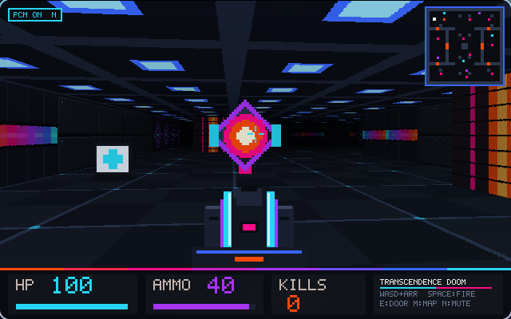
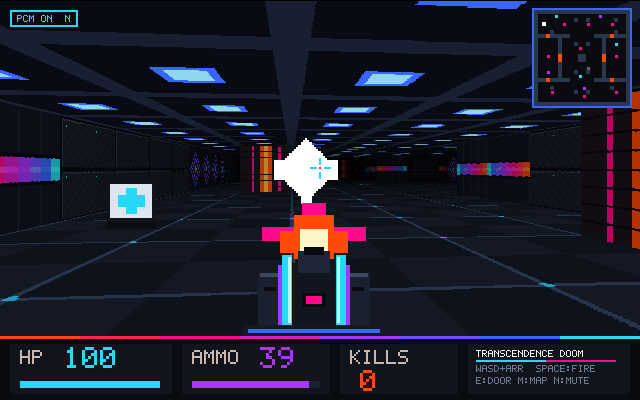
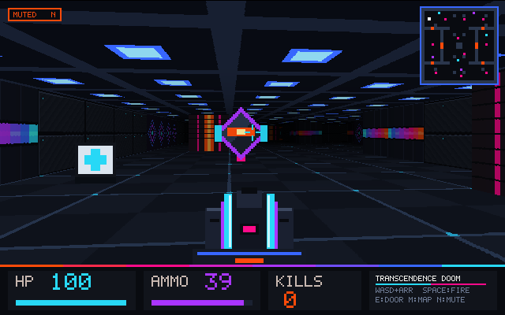
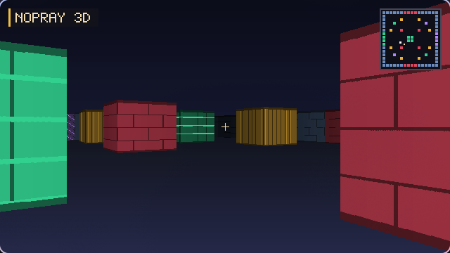
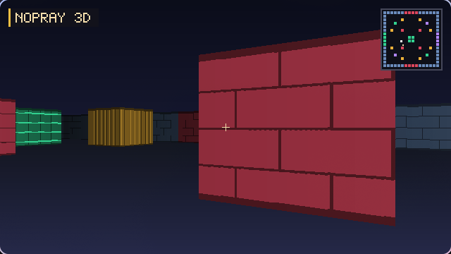
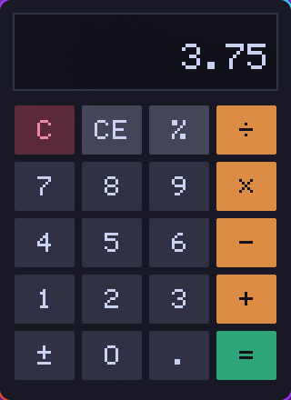

<p align="center">
  
</p>

<h1 align="center">NOPRAY</h1>

<p align="center">
  <strong>N</strong>ative <strong>O</strong>pcode <strong>P</strong>rotocol: <strong>R</strong>each the <strong>A</strong>lmighty <strong>Y</strong>ourself<br/>
  <em>«No Reces, Habla Directo con Dios» · "Don't Pray — Talk Direct to God"</em>
</p>

<p align="center">
  <code>DMCS-1.1</code> · Sin compilador · Sin ensamblador · Sin enlazador · Sin bibliotecas · Cada byte mapeado y auditado
</p>

<p align="center">
  <a href="./README.md">🇬🇧 Read in English</a> · <strong>🇪🇸 Español</strong> · <a href="./references/MANUAL.md">Manual completo (ES)</a> · <a href="./SKILL.md">Skill para Agentes</a> · <a href="./references/BENCHMARKS.md">Benchmarks Empíricos</a>
</p>

---

## ¿Qué es NOPRAY?

**NOPRAY** es una **skill para agentes de IA, estándar (`DMCS-1.1`) y herramienta de auditoría en Rust** para crear, auditar, modificar y portar ejecutables nativos escribiendo **directamente los bytes de código máquina** (ranuras fijas en hexadecimal + cabeceras ELF/binarias), **sin lenguaje de programación, sin compilador, sin ensamblador, sin enlazador y sin bibliotecas externas** (`libc`, `libX11`, `libpulse` y `libalsa` no existen aquí).

Escribir bytes crudos una sola vez es un truco curioso. Lograr que **otro agente o un humano pueda entenderlos, auditarlos y modificarlos meses después** es el verdadero reto de ingeniería. NOPRAY lo resuelve con tres pilares:

1. **Ranuras virtuales fijas (*fixed slots* en `nopray.toml`):** cada rutina vive en una dirección fija rellena con `NOP` de la arquitectura (`0x90` en x86-64, `1f 20 03 d5` en AArch64). Editar una rutina nunca desplaza las direcciones del resto.
2. **Intenciones por instrucción (`#= ...`):** cada línea de bytes declara qué instrucción quiso codificar el autor. `nopray audit` desensambla los bytes reales y caza errores de codificación (`I001`/`I002`/`I003`) antes de ejecutar nada.
3. **Una herramienta que nunca ensambla (`tools/nopray`):** escrita en Rust, `nopray` coloca los bytes en sus ranuras, los decodifica de vuelta, comprueba flujo de control, lista blanca de syscalls, permisos W^X, contratos de registros (`C011`/`C012`) y punteros interiores de datos (`C017`), y regenera `build/MAP.md` y filtros `seccomp`. **Jamás elige ni codifica una instrucción.**

---

## Demos reales y capturas de pantalla (cero bibliotecas)

Todos los ejemplos viven en [`examples/`](./examples/) y **se reconstruyen byte a byte y se auditan automáticamente** en cada ejecución de `cargo test`.

### 1. Transcendence DOOM — `32 768 B` (`32 KiB`) FPS 3D x86-64 + Audio PCM 24 kHz en vivo
- **Ficha auditada:** `DMCS-1.1` · Nivel **`L2` W^X** · `PT_GNU_STACK rw-` · **6 syscalls totales** (`socket`, `connect`, `read`, `write`, `poll`, `exit`) · **2 844 instrucciones x86-64 decodificadas** · **2 844 intenciones `#=` (0 discrepancias)** · `nopray audit --strict`: **`0 errores, 0 avisos`**.
- **Gráficos:** protocolo X11/Xwayland crudo (`/tmp/.X11-unix/X0`, `640×400` BGRA en 4 franjas `PutImage`), 7 texturas procedurales `64×64` y 6 sprites `32×32` RGBA generados al arranque en `.bss`, suelo y techo en perspectiva en punto fijo `16.16`, raycaster DDA SSE2 de 640 columnas con `zbuffer`, niebla SWAR de 256 niveles e iluminación por fogonazo, cañón de plasma bi-raíl animado, IA de Sentinels + bolas de plasma, puertas blindadas (`E`), HUD completo y radar minimapa (`M`).
- **Audio PCM directo:** protocolo nativo **PipeWire / PulseAudio** sobre `/run/user/<uid>/pulse/native` (`24 kHz S16LE mono`, cero `libpulse`, cero subprocesos y **cero syscalls adicionales**), con sintetizador de 5 voces en tiempo real (disparo plasma, explosiones con ruido LFSR + sub-grave, arpegio de recogida/puerta, aviso de daño y pulso de bajo industrial en Mi menor) y **mute instantáneo sin clics** (`N` o tecla multimedia `Mute`).

| En vivo en CachyOS / Hyprland (`PCM ON`) | Combate: fogonazo y flash blanco de impacto | Mute instantáneo (`MUTED  N`) |
| :---: | :---: | :---: |
|  |  |  |

### 2. Otros binarios de referencia verificados

| `nopray3d` — `8 192 B` Raycaster W^X 60 FPS | `nopray3d` — Sombreado de muros | `calc` — `4 096 B` (1 página OS) GUI X11 |
| :---: | :---: | :---: |
|  |  |  |

---

## La realidad de realidades: resultados empíricos sin maquillaje

Comparamos **NOPRAY** frente a **C (`gcc 14.2 -O2 -static`)**, **Rust (`rustc --release`)**, **Go (`CGO_ENABLED=0`)**, **Node.js (`v24`)** y **Python (`3.14`)** en ejecución real (`72/72` celdas bajo carga moderada, limitada y pesada) y en autoría, mantenimiento y portado multi-modelo (`70/70` celdas, `9 990/9 990` pruebas ocultas y auditoría forense de 12 ejecuciones). Detalle íntegro en [`references/BENCHMARKS.md`](./references/BENCHMARKS.md).

- **Dónde NOPRAY arrasa:**
  - **Arranque:** `330 µs` (`2×` más rápido que C estático, `2.4×` que Rust, `7.6×` que Go, `131×` que Python, `305×` que Node.js; con `CPUQuota=50%`, **`868×`** más rápido que Node.js).
  - **Huella y RAM viva:** **`1.2 KiB`** en disco y **`80 KiB` de RSS real** (`9.2×` menos RAM que C estático, `14×` menos que Rust, `824×` menos que Node.js).
  - **Superficie de syscalls:** solo **2–3 syscalls** distintas (frente a `13–14` en C, `21` en Rust, `34` en Python y `44` en Node.js).
- **En cómputo sostenido:**
  - Empata con C/Rust en criba de 300 millones (`3.11 s`) y hash FNV-1a de 512 MiB (`1.22 s` vs `1.20 s`).
  - En código con muchas ramas (`Collatz 10⁷`), el código ingenuo pierde (`3.69 s` vs `3.04 s` C), pero un bucle artesanal sin ramas (`shr + cmovb` alineado a 16 B en `nopray-opt`) **bate a todos**: **`2.456 s`** frente a Rust `2.535 s` y C `3.039 s` (`−33%`).
- **El coste real que no escondemos:**
  - **Escribir y mantener cuesta ~2× más que en C:** `555 s` y `2.90M` tokens frente a `272 s` y `1.45M` tokens en C (`3.5×` hasta el primer verde en Fase A).
  - **Portar de x86-64 a AArch64 cuesta reescribir** (`361 s` y `1.53M` tokens), mientras C, Rust y Go recompilan gratis.
  - **Lo que la auditoría NO prueba:** la pureza del proceso (sin compilador ni DSLs de campos de bits) es una declaración del autor, y sin compilador no hay comprobación automática de límites, canarios de pila ni ASLR. Para criptografía, TLS o sistemas grandes mantenidos por humanos, **Rust o C siguen siendo la herramienta correcta**.

---

## Inicio rápido

```bash
git clone https://github.com/Transcendenceia/nopray.git
cd nopray

# 1. Suite completa (reconstruye y audita byte a byte TODOS los ejemplos)
(cd tools/nopray && cargo test)

# 2. Compilar sin compilador y auditar en modo estricto Transcendence DOOM
./tools/nopray.sh build examples/nopray-doom-x86_64-cachyos
./tools/nopray.sh audit --strict examples/nopray-doom-x86_64-cachyos

# 3. Ejecutar Transcendence DOOM en Linux X11 / Xwayland (+ audio PipeWire PCM)
./examples/nopray-doom-x86_64-cachyos/build/nopray-doom
```

Documentación detallada en español: [`references/MANUAL.md`](./references/MANUAL.md). Licencia MIT — © 2026 [TranscendenceIA](https://github.com/Transcendenceia).
