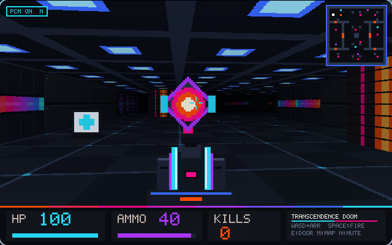
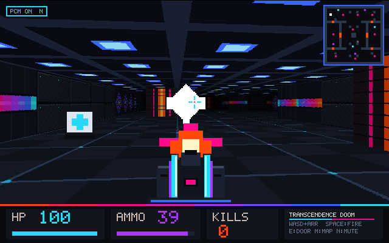
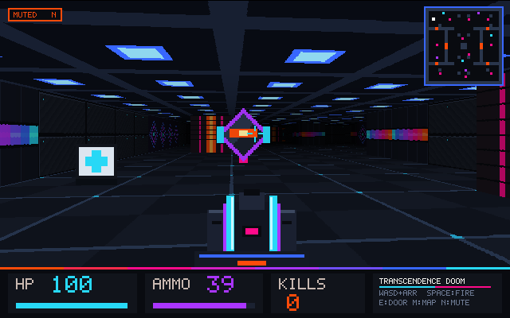
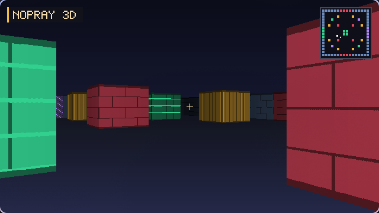
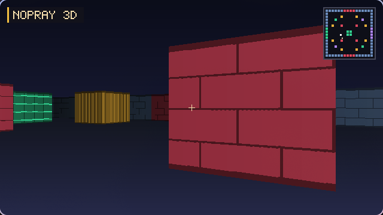
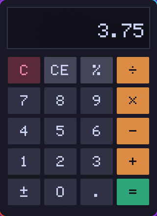

<p align="center">
  
</p>

<h1 align="center">NOPRAY</h1>

<p align="center">
  <strong>N</strong>ative <strong>O</strong>pcode <strong>P</strong>rotocol: <strong>R</strong>each the <strong>A</strong>lmighty <strong>Y</strong>ourself<br/>
  <em>"Don't Pray — Talk Direct to God" · «No Reces, Habla Directo con Dios»</em>
</p>

<p align="center">
  <code>DMCS-1.1</code> · No Compiler · No Assembler · No Linker · No Libraries · Every Byte Mapped &amp; Audited
</p>

<p align="center">
  <strong>English</strong> · <a href="./README.es.md">🇪🇸 Leer en Español</a> · <a href="./SKILL.md">AI Agent Skill</a> · <a href="./references/BENCHMARKS.md">Empirical Benchmarks</a> · <a href="./references/MANUAL.md">Manual (ES)</a>
</p>

---

## What is NOPRAY?

**NOPRAY** is an open-source **AI-agent skill, specification (`DMCS-1.1`), and Rust verification toolchain** for authoring, auditing, modifying, and porting native executables written **directly as machine-code bytes** (fixed-slot hexadecimal files + raw ELF/binary headers) — with **zero programming language, zero compiler, zero assembler, zero linker, and zero runtime libraries** (`libc`, `libX11`, `libpulse`, `libalsa` are all absent).

Writing raw bytes once is a party trick. Making them **readable, auditable, and modifiable months later by another agent or human** is the real engineering problem. NOPRAY solves that with three primitives:

1. **Fixed-Slot Virtual Address Layout (`nopray.toml`):** Every routine lives at a fixed virtual address padded with ISA `NOP`s (`0x90` on x86-64, `1f 20 03 d5` on AArch64). Editing one routine never shifts another routine's address.
2. **Per-Instruction Intents (`#= ...`):** Every line of hand-written machine code declares what the author intended to encode. `nopray audit` disassembles the actual bytes and flags every discrepancy (`I001`/`I002`/`I003`) before the binary ever runs.
3. **A Tool That Never Encodes (`tools/nopray`):** Written in Rust, `nopray` copies bytes into slots, decodes them back, verifies control flow, syscall allow-lists, W^X permissions, register contracts (`C011`/`C012`), and interior data pointers (`C017`), and regenerates `build/MAP.md` + `systemd` seccomp filters. **It never assembles or chooses an instruction.**

```text
Natural-language intent ── AI agent ──▶ Mapped machine-code slots (.hex + nopray.toml)
                                            │ nopray build / audit / annotate (zero encoding)
                                            ▼
                                  Native binary + MAP.md + audit.json ──▶ CPU
```

---

## Live Demos & Screenshots (Real Binaries, Zero Libraries)

Every demo below lives in [`examples/`](./examples/) and is **rebuilt byte-for-byte and audited automatically** by `cargo test` in CI.

### 1. Bare-Metal `Qwen3-TTS-12Hz-0.6B` VM — `32,768 B` (`32 KiB`) Neural Speech Synthesis with **Zero Linux**
- **Specs:** `DMCS-1.1` · Tier **`L3` W^X** · **Multiboot 1 ELF32 → 64-bit Long Mode + AVX2/FMA/F16C** · **0 Linux syscalls** (no OS kernel!) · **12 hand-authored hex slots** · **2,806 decoded x86-64 instructions** · `nopray audit --strict`: **`0 errors, 0 warnings`**.
- **Full End-to-End Pipeline on Bare Metal:** boots straight on QEMU/KVM (`-enable-kvm -cpu host -smp 1`), constructs 4-level 2 MiB identity page tables (`0..4 GiB`), switches 32→64 Long Mode via `jmp far 0x08:boot64`, enables `XCR0=7` AVX2+FMA+F16C, maps `weights.nqts` (`1.042 GiB` `DMCS-L3`) zero-copy from `-initrd`, executes **Talker 28L + Code Predictor 5L** (`Q8_0S` AVX2 GEMV, RoPE, QK-Norm, GQA KV-cache, SwiGLU) + **Speech Tokenizer 12Hz V2 Decoder** (16-codebook RVQ, `pre_conv`, 8-layer sliding-window=72 Pre-Transformer, 2× ConvNeXt, 4-stage BigVGAN/SnakeBeta with `2oc × 48t` tiled AVX2+FMA+F16C convolutions), streams a complete `24 kHz S16LE` RIFF/WAVE via `isa-debugcon` (`0xE9` `rep outsb`), and powers off cleanly (`isa-debug-exit`).
- **Real Audio Proof (`"Hola Marlon, esto es código máquina puro con nopray, sin Linux y sin compilador."`, speaker `serena`, `Spanish`):**
  - 🔊 **Bare-metal NOPRAY output (`6.40 s`, `301 KiB`):** [`assets/audio/nopray_qwen3_tts_baremetal_es.wav`](./assets/audio/nopray_qwen3_tts_baremetal_es.wav) — **`89.32 dB` SNR / `0.9999999994` cosine** vs FP32 NumPy (`153,359 / 153,600` bit-identical PCM samples, max diff `±1 LSB`).
  - 🔊 **Official `qwen-tts` PyTorch reference (`6.72 s`, `316 KiB`):** [`assets/audio/official_qwen3_tts_pytorch_es.wav`](./assets/audio/official_qwen3_tts_pytorch_es.wav).
- **Head-to-Head on Identical Silicon (AMD Ryzen 7 5825U):** **1-vCPU bare-metal NOPRAY (`41.22 s` synth / `53.04 s` cold / `2.37 GiB` RSS / `32 KiB` ELF / `0` Linux syscalls)** beat **every** official `qwen-tts` PyTorch CPU configuration — including **`8-thread FP32`** (`54.15 s` synth / `63.51 s` cold / `5.52 GiB` RSS / `1.375 GiB` `.venv` / `134,879+` Linux syscalls on import+load alone) and **`8-thread BF16`** (`411.52 s`). Full numbers in [`examples/qwen3-tts-x86_64-baremetal/`](./examples/qwen3-tts-x86_64-baremetal/) and [`references/BENCHMARKS.md`](./references/BENCHMARKS.md#part-3--bare-metal-neural-tts-32-kib-nopray-kvm-vs-official-qwen-tts-pytorch).

### 2. Transcendence DOOM — `32,768 B` (`32 KiB`) x86-64 3D FPS + Live 24 kHz PCM Audio
- **Specs:** `DMCS-1.1` · Tier **`L2` W^X** · `PT_GNU_STACK rw-` · **6 syscalls total** (`socket`, `connect`, `read`, `write`, `poll`, `exit`) · **2,844 decoded x86-64 instructions** · **2,844 `#=` intents (0 mismatches)** · `nopray audit --strict`: **`0 errors, 0 warnings`**.
- **Graphics:** Raw X11/Xwayland wire protocol (`/tmp/.X11-unix/X0`, `640×400` BGRA in 4 horizontal `PutImage` strips), 7 procedural `64×64` wall/floor/ceiling textures & 6 procedural `32×32` RGBA sprites generated at startup in `.bss`, `16.16` fixed-point perspective floor/ceiling casting, 640-column SSE2 DDA wall raycaster with per-column Z-buffer, SWAR 256-level distance fog & dynamic muzzle-flash lighting, animated Twin-Rail Plasma Cannon, Sentinel AI + fireballs, interactive blast doors, HUD & radar minimap.
- **Audio:** Direct real-time **PipeWire / PulseAudio native Unix socket PCM** (`/run/user/<uid>/pulse/native`, `24 kHz S16LE mono`, zero `libpulse`, zero `fork`/`execve`, **zero extra syscalls**) synthesizing 5 live voices (sweeping plasma shot, sub-bass + LFSR noise explosions, rising pickup/door chimes, hurt alert, and an E-minor industrial bass pulse) with instant click-free mute (`N` or `XF86AudioMute`).

| Live on CachyOS / Hyprland (`PCM ON`) | Mid-Combat Muzzle Flash & White Hit-Flash | Instant Mute Toggle (`MUTED  N`) |
| :---: | :---: | :---: |
|  |  |  |

### 3. More Verified Reference Binaries

| `nopray3d` — `8,192 B` W^X 60 FPS Raycaster | `nopray3d` — Textured Wall Shading | `calc` — `4,096 B` (Single OS Page) X11 GUI |
| :---: | :---: | :---: |
|  |  |  |

| Example | Exact Size | ISA / Target | Tier & Syscalls | Verification |
| :--- | ---: | :--- | :--- | :--- |
| [`hello-aarch64-linux`](./examples/hello-aarch64-linux/) | `384 B` | AArch64 Linux | L2 W^X · 2 syscalls | `qemu-aarch64`, strict audit `0/0`, full intents |
| [`hello-riscv64-linux`](./examples/hello-riscv64-linux/) | `384 B` | RISC-V 64 Linux | L2 W^X · 2 syscalls | `qemu-riscv64`, strict audit `0/0`, full intents |
| [`calc-x86_64-cachyos`](./examples/calc-x86_64-cachyos/) | `4,096 B` | x86-64 X11 | L1 (local) · 6 syscalls | Live desktop screenshots, byte-locked map |
| [`nopray3d-x86_64-cachyos`](./examples/nopray3d-x86_64-cachyos/) | `8,192 B` | x86-64 X11 | L2 W^X · 6 syscalls | Live desktop screenshots, 60 FPS, byte-locked map |
| [`nopray-doom-x86_64-cachyos`](./examples/nopray-doom-x86_64-cachyos/) | `32,768 B` | x86-64 X11 + PipeWire PCM | L2 W^X · 6 syscalls | Live CachyOS + active PipeWire PCM stream + strict audit `0/0` |
| [`qwen3-tts-x86_64-baremetal`](./examples/qwen3-tts-x86_64-baremetal/) | `32,768 B` | x86-64 Bare Metal (Multiboot 1 + AVX2/FMA/F16C) | L3 W^X · **0 syscalls** | Live `/dev/kvm` Spanish WAV (`89.32 dB` SNR) + strict audit `0/0` |
| [`nopray-httpd-x86_64-linux/v2`](./examples/nopray-httpd-x86_64-linux/) | `40,960 B` | x86-64 Linux SSR HTTP/1.1 | L2 W^X · 13 syscalls | Byte-identical map, systemd + seccomp hardening template |

---

## The Reality of Realities: Empirical Benchmarks (No Hype)

We ran a full, reproducible benchmark suite comparing **NOPRAY** against **C (`gcc 14.2 -O2 -static`)**, **Rust (`rustc --release`)**, **Go (`CGO_ENABLED=0`)**, **Node.js (`v24`)**, and **Python (`3.14`)** across **runtime execution (`72/72` cells)** and **multi-model AI authoring, maintenance, and cross-ISA porting (`70/70` cells, `9,990/9,990` hidden tests, 12-run forensic purity audit)**. Full numbers and methodology live in [`references/BENCHMARKS.md`](./references/BENCHMARKS.md).

### 1. Where NOPRAY Crushes Conventional Stacks (Footprint, Startup, Attack Surface)

| Implementation | Binary on Disk | Total Deployed (App + Runtime) | Live RSS (`smaps_rollup`) | Distinct Syscalls (`h` / `f`) | Startup Latency (`h`, median) | Throttled Startup (`CPUQuota=50%`) |
| :--- | ---: | ---: | ---: | :---: | ---: | ---: |
| **NOPRAY (`DMCS-L2`)** | **`1.2 KiB`** | **`1.2 KiB`** | **`80 KiB`** | **`2` / `3`** | **`330 µs`** | **`332 µs`** |
| C (`-O2 -static`) | `660.4 KiB` | `660.4 KiB` | `736 KiB` | `13` / `14` | `642 µs` | `643 µs` |
| Rust (`--release`) | `1.1 MiB` | `1.1 MiB` | `1.1 MiB` | `21` / `21` | `790 µs` | `791 µs` |
| Go (`static`) | `1.4 MiB` | `1.4 MiB` | `2.1 MiB` | `22` / `23` | `2.5 ms` | `2.5 ms` |
| Python `3.14` | `1.9 KiB` | `75.7 MiB` | `10.9 MiB` | `34` / `34` | `43.4 ms` | `97.1 ms` |
| Node.js `v24` | `1.9 KiB` | `123.6 MiB` | `64.4 MiB` | `44` / `44` | `100.5 ms` | `288.1 ms` (**868× slower**) |

### 2. Sustained Compute: Naive Hand-Code Loses to Compilers; Branchless Hand-Code Beats Them

| Heavy Workload | NOPRAY (naive) | NOPRAY (`nopray-opt`) | C (`-O2`) | Rust (`--release`) | Go | Node.js | Python |
| :--- | ---: | ---: | ---: | ---: | ---: | ---: | ---: |
| **Sieve `3×10⁸`** (286 MiB RAM) | **`3.11 s`** | **`3.11 s`** | **`3.11 s`** | `3.13 s` | `3.47 s` | `3.90 s` | `109.27 s` |
| **FNV-1a `512 MiB`** (I/O + hash) | `1.22 s` | `1.22 s` | **`1.20 s`** | **`1.20 s`** | `1.21 s` | `1.33 s` | `115.95 s` |
| **Collatz `10⁷`** (branch-heavy) | `3.69 s` (+21% vs C) | **`2.456 s` (−19% vs C)** | `3.039 s` | `2.535 s` | `3.77 s` | `37.82 s` | `201.08 s` |

Replacing one 70-byte slot (`0240_collatz.hex`) with a 16-byte-aligned 6-instruction branchless `shr + cmovb` loop cut Collatz time by **33–36%** and beat both `gcc -O3 -march=native` and `rustc --release`.

### 3. The Honest Cost: Authoring, Maintenance & Porting (`jstat` Strict JSON Validator, `n = 3`)

| Language | Phase A+B Wall Time (mean) | Tokens Processed (A+B) | Time to First Green (Phase A) | Cross-ISA Port to AArch64 | Hidden Tests Passed |
| :--- | ---: | ---: | ---: | :--- | :---: |
| **Go** | `266 s` | `1.23M` | `71 s` | Free (`GOARCH=arm64`) | `100%` |
| **C** | `272 s` | `1.45M` | `71 s` | Free (`aarch64-gcc`) | `100%` |
| **JavaScript** | `301 s` | `1.32M` | `84 s` | Runtime-portable | `100%` |
| **Rust** | `301 s` | `2.24M` | `112 s` | Free (`--target aarch64`) | `100%` |
| **Python** | `485 s` | `2.17M` | `83 s` | Runtime-portable | `100%` |
| **NOPRAY** | **`555 s` (2.05× C)** | **`2.90M` (2.02× C)** | **`251 s` (3.5× C)** | **`361 s` + `1.53M` tokens (manual rewrite)** | **`100%`** |

### What NOPRAY Proves — and What It Does **NOT** Prove

- **What `nopray audit` proves:** the binary is byte-identical to the map (`R000`), every byte has an owner (`G001`), every instruction decodes cleanly (`C001`), control flow only crosses slots via declared entries (`C005`), W^X and non-executable stack hold (`S001`/`S003`/`S006`), the statically resolved syscall surface matches `[syscalls]` (`C008`), register contracts match (`C011`/`C012`), interior data pointers hit declared labels (`C017`), and `#=` intents match the decoded bytes (`I001`–`I003`).
- **What it CANNOT prove:**
  - **Purity of origin:** an audit proves what the bytes *do*, never how they were produced. Purity tiers (`L0`–`L3`) are author attestations (`[provenance]`), backed by process discipline (no compilers, no assemblers, and **no custom bit-field encoder DSLs**).
  - **Memory safety by construction:** without a compiler, there are no automatic bounds checks, stack canaries, or ASLR (fixed load address `0x400000`). Network-exposed binaries require `L2` W^X, `nopray seccomp`, a strict `systemd` sandbox behind a reverse proxy, and adversarial input testing.
  - **When to use NOPRAY vs. Rust/C:** NOPRAY excels at tiny ultra-auditable tools, instant-startup micro-binaries, minimal seccomp surfaces, research, and bare-metal exploration. For complex business apps, cryptography, TLS, and human teams, **use Rust or C**.

---

## Quick Start

Requires Rust (`cargo`) for building the `nopray` auditor tool on first run.

```bash
git clone https://github.com/Transcendenceia/nopray.git
cd nopray

# 1. Run the full tool test suite (rebuilds & audits EVERY example byte-for-byte)
(cd tools/nopray && cargo test)

# 2. Audit and build the 32 KiB Bare-Metal Qwen3-TTS VM & Transcendence DOOM (strict 0 errors / 0 warnings)
./tools/nopray.sh audit --strict examples/qwen3-tts-x86_64-baremetal
./tools/nopray.sh build examples/nopray-doom-x86_64-cachyos
./tools/nopray.sh audit --strict examples/nopray-doom-x86_64-cachyos

# 3. Run Transcendence DOOM on Linux X11 / Xwayland (with optional PipeWire PCM audio)
./examples/nopray-doom-x86_64-cachyos/build/nopray-doom

# 4. Run cross-ISA examples under qemu-user
qemu-aarch64 examples/hello-aarch64-linux/build/hello-aarch64
qemu-riscv64 examples/hello-riscv64-linux/build/hello-riscv64
```

### Using NOPRAY as an AI Agent Skill

Drop this repository into your agent's skills directory (OpenClaw, Claude Code, Codex, Antigravity, etc.) pointing to [`SKILL.md`](./SKILL.md), then prompt:

> *"Use the `nopray` skill. Fingerprint the target and build `<application>` in hand-authored machine code, tier L2, exposure `local`. Deliver `nopray.toml`, slots with `#=` intents, a clean `audit --strict`, `MAP.md`, and live execution evidence."*

---

## Documentation Library

| Document | Language | Topic |
| :--- | :---: | :--- |
| [`SKILL.md`](./SKILL.md) | EN | Canonical AI agent instructions, non-negotiable rules, commands, decoder matrix |
| [`references/WORKFLOW.md`](./references/WORKFLOW.md) | EN | Step-by-step create / port / modify workflow, encoding traps (`REX.R/X/B`, AArch64 `Rn[9:5]`, `C017`) |
| [`references/MANIFEST.md`](./references/MANIFEST.md) | EN | Complete `nopray.toml` schema, slot syntax, and every audit finding code (`R000`–`A001`, `C017`) |
| [`references/BENCHMARKS.md`](./references/BENCHMARKS.md) | EN | Full empirical results vs C, Rust, Go, Node.js, and Python (execution + multi-model authoring) |
| [`references/GRAPHICS-SUBSTRATES.md`](./references/GRAPHICS-SUBSTRATES.md) | EN | Raw X11/Xwayland (`640×400`), **verified PipeWire/PulseAudio PCM**, Wayland `wl_shm`, `/dev/fb0`, TTY, TCP |
| [`references/SECURITY.md`](./references/SECURITY.md) | EN | Threat model, what audits prove vs. cannot prove, exposure gates, `systemd` + `seccomp` checklist |
| [`references/TARGETS.md`](./references/TARGETS.md) | EN | Verified vs. unverified target matrix (Linux x86-64/AArch64/RISC-V, ESP32-C3/C6, RP2040/RP2350, RPi) |
| [`references/ELF64-X86_64-SPEC.md`](./references/ELF64-X86_64-SPEC.md) | EN | Byte-exact ELF64 headers, Linux syscalls, x86-64 opcode reference & encoding pitfalls |
| [`references/FIXED-SLOT-ABI.md`](./references/FIXED-SLOT-ABI.md) | EN | Fixed-slot architecture, W^X segmentation, and dedicated state-register ABI |
| [`references/ENV-DISCOVERY.md`](./references/ENV-DISCOVERY.md) | EN | Target host fingerprinting (ISA, display, audio, keycodes, WM hints) |
| [`references/HUMAN-AUDIT-PROTOCOL.md`](./references/HUMAN-AUDIT-PROTOCOL.md) | EN | Independent verification checklist for humans or second agents |
| [`references/MANUAL.md`](./references/MANUAL.md) | ES | Manual completo en español: filosofía, logros verificados, límites honestos y hoja de ruta |

---

## License

MIT — © 2026 [TranscendenceIA](https://github.com/Transcendenceia).
