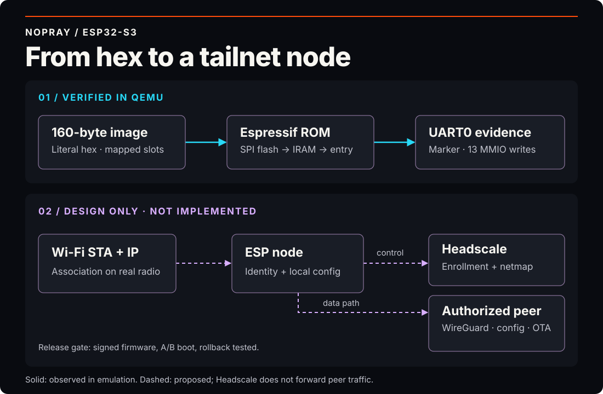

# AgujaESP-NOPRAY · primera prueba de arranque

[English: reproducción, mapa y fuentes](README.md) · [Diseño técnico](DESIGN.md) · [Evidencia](EVIDENCE.md)

La ROM del ESP32-S3 emulado cargó **160 bytes escritos a mano** y UART0 devolvió `NOPRAY-S3 OK`. En QEMU, la ROM también rechazó la imagen al cambiar un bit de la suma de comprobación. En el N16R8 físico, la ROM cargó esos mismos bytes **en RAM** y la UART devolvió el mismo marcador, sin sustituir el firmware instalado. Ni el auditor ni el emulador generan instrucciones para el firmware; la ROM de Espressif sí es un prerrequisito externo.

**Este binario no se debe flashear**: la geometría de 4 MiB es del emulador. Faltan la prueba de arranque desde flash en la placa y toda la conectividad. El auditor comprueba el mapa, pero **todavía no decodifica Xtensa**; la decodificación y los accesos de esta prueba vienen de QEMU.

## De La Aguja al S3, sin confundir los caminos

La Aguja ya aporta un referente de comportamiento: aprovisionamiento local, Wi‑Fi, identidad propia en Headscale, administración y OTA con reversión. Su implementación ESP-IDF/MicroLink no se reutiliza dentro del binario NOPRAY. Un router de subred puede dar acceso a una placa, pero no la convierte en nodo independiente de Headscale.

El camino restante es: **identificar y respaldar el módulo → probar el arranque físico → conseguir asociación Wi‑Fi e IP → demostrar alta y persistencia de identidad → probar tráfico y administración → instalar y revertir una imagen nueva**. Se comprueba cada etapa por separado, sin tomar un alta registrada como prueba de túnel ni tomar un túnel como permiso para instalar código. No hace falta habilitar salida a Internet para otros nodos ni anunciar rutas de la casa.

Para seguir leyendo: [arquitectura, límites y criterios de aceptación](DESIGN.md). El [README técnico](README.md) incluye la receta para modificar una instrucción, actualizar los sellos de integridad y repetir la prueba.

## Primer port del software de radio

El [binario de referencia de La Aguja](reference-import/) se reconstruye byte por byte en
17 ranuras de carga. Eso conserva su estructura, no convierte el binario ESP-IDF en firmware
escrito a mano ni recupera sus funciones. Por separado, la [rutina del PHY portada](ports/phy-txbbgain/)
sí está escrita en hex literal y pasa siete casos en QEMU y en el N16R8 por RAM. Traduce un
valor de ganancia digital a un índice; **no inicializa la radio ni se asocia a Wi‑Fi**.
