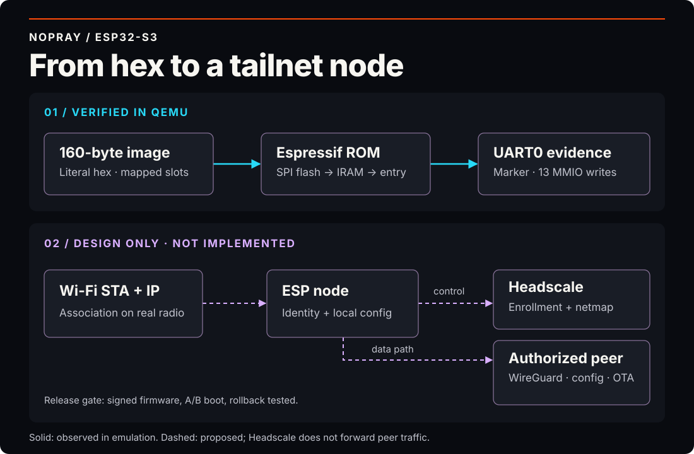

# AgujaESP-NOPRAY · ESP32-S3 bring-up

[Español](README.es.md) · [Architecture and acceptance gates](DESIGN.md) · [Recorded evidence](EVIDENCE.md)



This **160-byte emulation probe** is written as literal Xtensa machine-code bytes and ESP image fields. Espressif's pre-existing ROM loads it at power-on; it then writes `NOPRAY-S3 OK` once to UART0 and spins. No guest compiler, assembler, linker, SDK, vendor Wi-Fi blob, or programming-language source was used. The ROM is an external execution prerequisite. Authorship is an attestation, not something an auditor can prove. The host test harness and auditor are not part of the firmware.

**Not a deployable tailnet node.** No real-board claim, RF association, WPA handshake, IP stack, Headscale registration, WireGuard, management service, or OTA. The DMCS L1 audit leaves `S001` (writable executable IRAM) and `X001` (opaque Xtensa code) open. QEMU decodes the 28 instructions and records observed writes, but does not replace a native audit. Do not flash this fixture: its 4 MiB/DIO configuration is for QEMU, not a WROOM module profile.

## Reproduce

Run from the repository root on Linux. Use Espressif QEMU's [9.2.2 release dated 2026-11-09](https://github.com/espressif/qemu/releases/tag/esp-develop-9.2.2-20261109); extract the matching host archive into a scratch directory after checking the release digest. On Linux x86-64 the tested archive SHA-256 was `fbc3bffa9fa71192847969a627a584aabe2e86d85bed4902a096ff06c2b8a815`.

```sh
A=examples/agujaesp-nopray-s3
T=./tools/nopray.sh
"$T" annotate --check "$A"
"$T" build "$A"
"$T" audit "$A" --binary "$A/build/agujaesp-s3-uart.bin"
"$A/verify-qemu.sh" /path/to/qemu/bin/qemu-system-xtensa ./agujaesp-qemu-evidence
```

The script takes a **new** evidence directory. It verifies the stored XOR and SHA-256, confirms SPI ROM boot, exactly one UART marker and 13 writes to UART0, and demonstrates rejection of a one-bit checksum mutation. It never opens a physical device or enables networking. Use the machine's default CPU count; `-smp 1` crashed during this run. Do not use `-kernel`: that would bypass the ROM-from-flash path under test. Good-case QEMU exit `124` is the harness stopping the intentional spin.

## Read and change the image

| File range | Bytes | Who uses it |
|---|---:|---|
| `00–17` | 24 | ROM header: chip ID 9, one segment, DIO, entry `0x403C8704` |
| `18–1F` | 8 | Segment descriptor: `0x403C8700`, 88 bytes |
| `20–23` | 4 | Literal `0x60000000` (UART0 FIFO) |
| `24–77` | 84 | 28 three-byte Xtensa instructions |
| `78–7F` | 8 | Seven zeros and XOR `0x12` |
| `80–9F` | 32 | SHA-256 of `00–7F` (integrity, not authenticity) |

For an in-place edit, copy the sample first. To change the final `K` to `!`, hand-edit `32 a0 4b` → `32 a0 21` and update its intent; no address moves. XOR all bytes `20–77` starting at `0xEF` (the new checksum is `0x78` in this example). Recompute SHA-256 over bytes `00–7F` and store it as the last slot. Rebuild, compare with `nopray diff`, rerun, and check decoded instructions and the new UART marker. The supplied verifier intentionally pins the original marker and will not pass a changed image unchanged.

### Primary references

- [ESP-IDF v5.5 ESP image structure](https://github.com/espressif/esp-idf/blob/v5.5/components/bootloader_support/include/esp_app_format.h) and [esptool v5.1.0 serialization and checksum](https://github.com/espressif/esptool/blob/v5.1.0/esptool/bin_image.py).
- [esptool ESP32-S3 chip ID and flash offset](https://github.com/espressif/esptool/blob/v5.1.0/esptool/targets/esp32s3.py); the image goes at `0x0` in the simulated flash.
- [ESP-IDF S3 bootloader load region](https://github.com/espressif/esp-idf/blob/v5.5/components/bootloader/subproject/main/ld/esp32s3/bootloader.ld): derive `0x403C8700` from the start of `iram_seg`. This is a reference, not a linked input.
- [S3 MMIO bases](https://github.com/espressif/esp-idf/blob/v5.5/components/soc/esp32s3/register/soc/reg_base.h), [UART registers](https://github.com/espressif/esp-idf/blob/v5.5/components/soc/esp32s3/register/soc/uart_reg.h), and [S3 Xtensa ISA tables used by the QEMU decoder](https://github.com/espressif/qemu/blob/esp-develop-9.2.2-20261109/target/xtensa/core-esp32s3/xtensa-modules.inc.c).
