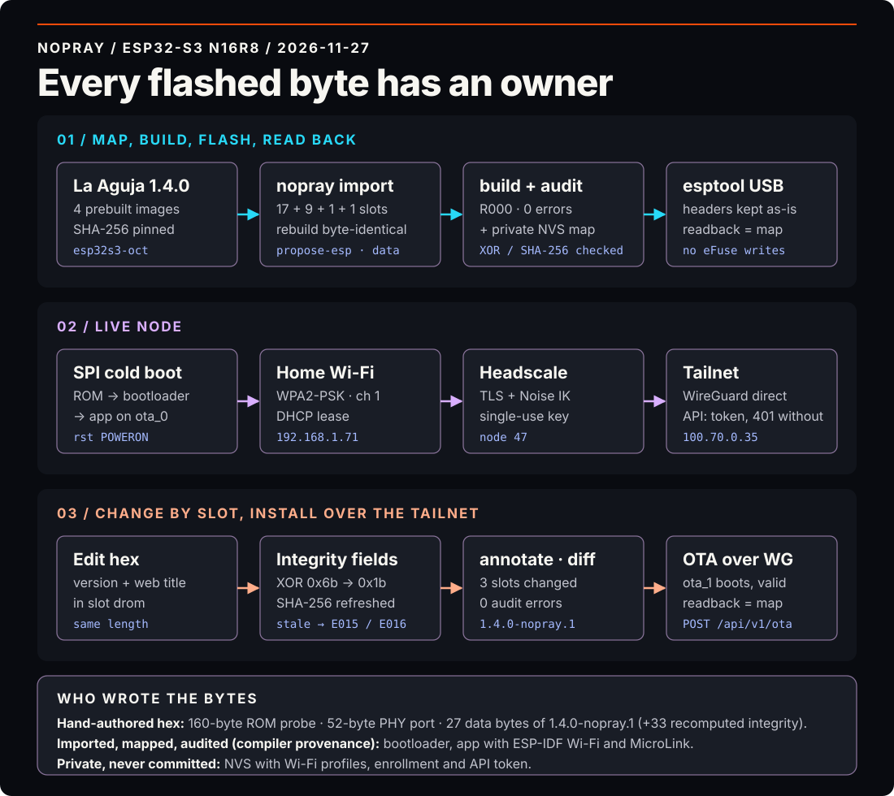

# AgujaESP-NOPRAY · nodo vivo de la tailnet en un ESP32-S3 N16R8

[English](README.md) · [Prueba y diseño](../README.es.md) · [Evidencia](../EVIDENCE.md#live-node-2026-11-27)

**Estado, 27/11/2026:** la placa se conecta al Wi‑Fi de casa y se da de alta en Headscale
como nodo 47 (`agujaesp-nopray`, `100.70.0.35`). Responde a su API por WireGuard y aceptó
un cambio NOPRAY por su OTA autenticada. Cada byte grabado sale de `nopray build`, y la
lectura de vuelta coincidió con su mapa.

## Qué está escrito a mano y qué está portado

| Bytes | Procedencia | Cómo los sostiene NOPRAY |
|---|---|---|
| Sonda ROM de 160 bytes, rutina PHY de 52 | Hex literal de Angie | Ranuras por función con intenciones `#=` |
| 27 bytes de datos de `1.4.0-nopray.1` | Hex literal de Angie | Líneas editadas en la ranura `drom` ([parche](edits/1.4.0-nopray.1.patch)) |
| 33 bytes de integridad (XOR y SHA‑256) | Calculados a partir de los bytes | Ranuras propias; `audit` los recalcula |
| Bootloader y app con Wi‑Fi ESP‑IDF, lwIP, mbedTLS y MicroLink | Compilación de La Aguja 1.4.0 | Importados por segmento, idénticos y auditados |
| Tabla de particiones y `otadata` | Compilación de La Aguja 1.4.0 | Una ranura `format = "data"` cada una |
| NVS (Wi‑Fi, clave de alta, token de la API) | Generada en local con `iot-nvs` | Mapa privado; nunca se publica |

Es la **vía de port** de la skill: primero una importación idéntica byte a byte y después
la reescritura función por función. El código de radio, IP, TLS y WireGuard está mapeado,
no reescrito. No hay que presentarlo como firmware escrito a mano por completo.

## Cómo se cambia: ranura, auditoría, OTA

1. Copiar la versión a un directorio nuevo y editar bytes en una ranura, con la misma longitud.
2. Recalcular el XOR y el SHA‑256 del contenedor. Si se olvida, `nopray audit` da `E015`/`E016`.
3. `annotate`, `build`, `audit` y `diff`; aquí cambiaron solo `drom` y los dos campos de integridad.
4. `POST /api/v1/ota` con el token por la tailnet. La placa arrancó en `ota_1`, volvió a
   `CONNECTED` en 10 s, siguió ahí pasada la ventana de reversión y la lectura por serie
   coincidió con el mapa.

Los comandos exactos, la tabla de flash y la receta para reproducirlo están en el
[README técnico](README.md).

## Límites

- **La puerta de exposición no se cumple tal como está escrita:** el nodo es alcanzable en la
  tailnet y la política pide L2, W^X y seccomp. Esos controles son de Linux; aquí la IRAM es
  `rwx` y el auditor no decodifica Xtensa. Lo desplegué porque lo pidió Marlon, con la API
  limitada a la IP de la tailnet y protegida por token, sin acceso por LAN, sin SoftAP y sin
  rutas aprobadas.
- **MicroLink anuncia `0.0.0.0/0`** aunque la NVS diga `exit=0`. Headscale la tiene como
  disponible, no aprobada; debe seguir así.
- **La OTA exige token, pero no firma.** Falta una clave de firma fijada.
- Siguiente port: los manejadores de configuración y HTTP, y después el camino de radio.
