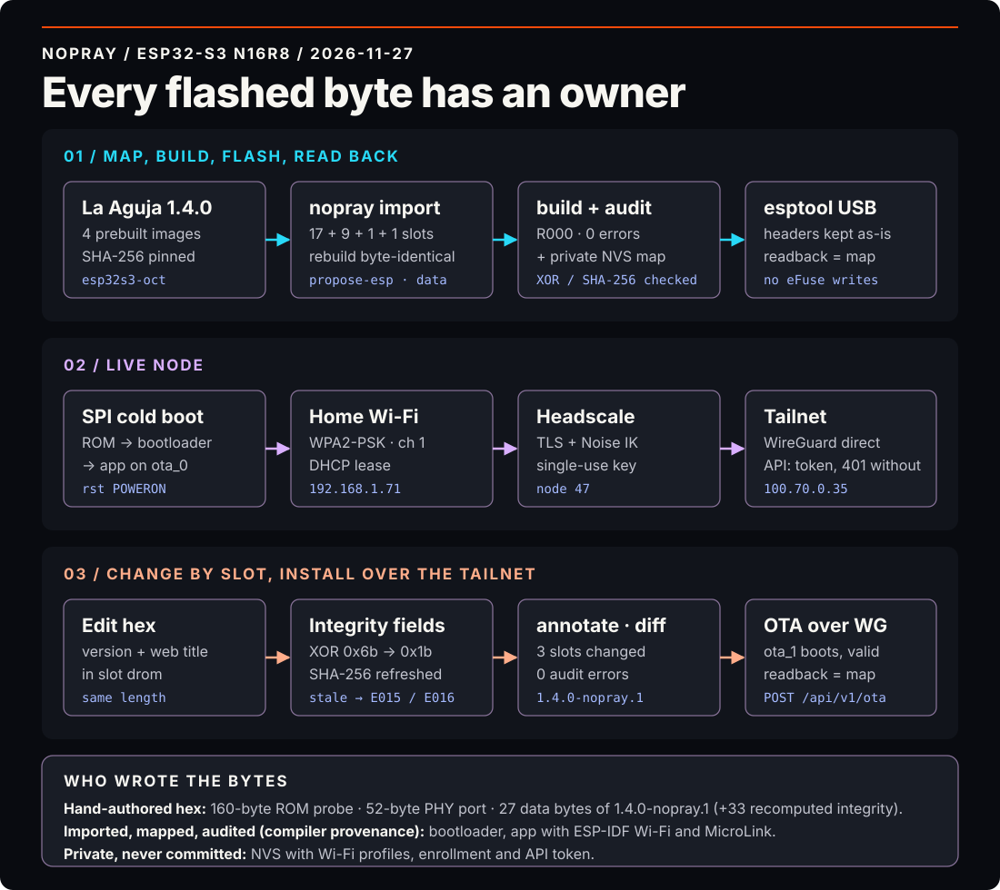

# AgujaESP-NOPRAY · live tailnet node on an ESP32-S3 N16R8

[Español](README.es.md) · [Probe and design](../README.md) · [Evidence](../EVIDENCE.md#live-node--2026-11-27)



**Status, 2026-11-27:** the board joins the home Wi-Fi, registers with Headscale as node 47
(`agujaesp-nopray`, `100.70.0.35`), answers its API over WireGuard and accepted a
NOPRAY slot edit through its authenticated OTA endpoint. Every byte written to flash comes
from `nopray build` and was read back identical to its map.

## What is hand-authored and what is ported

| Bytes | Provenance | How NOPRAY holds them |
|---|---|---|
| 160-byte ROM probe, 52-byte PHY routine | Literal hex by Angie | Function-level slots with `#=` intents ([probe](../), [port](../ports/phy-txbbgain/)) |
| 27 data bytes of `1.4.0-nopray.1` | Literal hex by Angie | Edited lines in slot `drom` ([patch](edits/1.4.0-nopray.1.patch)) |
| 33 integrity bytes (XOR, SHA-256) | Computed from the bytes | Slots `alignment_checksum`, `appended_digest`; `audit` recomputes both |
| Bootloader, app incl. ESP-IDF Wi-Fi, lwIP, mbedTLS, MicroLink | La Aguja 1.4.0 build (compiler) | Imported at loader-segment granularity, byte-identical, audited |
| Partition table, `otadata` | La Aguja 1.4.0 build | One `format = "data"` slot each |
| NVS (Wi-Fi, enrollment key, API token) | Generated locally by La Aguja `iot-nvs` | Private `format = "data"` map; never committed |

This is the **port track** of the skill: a byte-identical import first, then
function-by-function re-authoring. The radio, IP, TLS and WireGuard code is mapped,
not rewritten. Do not describe this node as all-authored firmware.

## Flash layout

| Offset | Image | Slots | SHA-256 |
|---|---|---|---|
| `0x0` | `bootloader.bin` | 9 | `bd0d1ced…` |
| `0x8000` | `partition-table.bin` | 1 | `8f24b37d…` |
| `0x9000` | `nvs.bin` (private) | 1 | not published |
| `0x15000` | `ota_data_initial.bin` | 1 | `7d2c7ac4…` |
| `0x20000` (`ota_0`) | `aguja_iot.bin` 1.4.0 | 17 | `e8a1c9dd…` |
| `0x200000` (`ota_1`) | `1.4.0-nopray.1`, installed over the tailnet | 17 | `cdfca3e6…` |

## Reproduce the public maps

```sh
NOPRAY=/path/to/nopray ./reproduce.sh /path/to/La-Aguja/iot/prebuilt/esp32s3-oct
```

It checks the four input hashes, imports and audits each image (`R000`), applies the edit
patch and fails unless the result is `cdfca3e6…`. It never opens a serial port.

## Deploy (owner-approved hardware write)

1. **Back up and identify.** `esptool read-flash 0 0x1000000` and `verify-flash`; keep the
   dump private. This board was blank (all `0xFF`).
2. **Provision privately.** Create a single-use, non-ephemeral Headscale pre-auth key, then
   generate the NVS with La Aguja `iot-nvs`: `board_id = esp32s3-wroom-n16r8`, hostname
   `AgujaESP-NOPRAY`, SoftAP, exit node, routes and DNS relay off, `http_allow_lan = false`.
   Map it with a `format = "data"` manifest, audit it, and shred the file after flashing.
3. **Flash without rewriting headers:**

   ```sh
   esptool --chip esp32s3 --port /dev/ttyACM0 --baud 921600 write-flash \
     --flash-mode keep --flash-freq keep --flash-size keep \
     0x0 bootloader.bin 0x8000 partition-table.bin 0x9000 nvs.bin \
     0x15000 ota_data_initial.bin 0x20000 aguja_iot.bin
   ```

   `keep` matters: otherwise esptool patches the bootloader header and the flash no longer
   equals the map.
4. **Read back** each region and run `nopray audit DIR --binary READBACK` before first boot.
5. **Boot and verify:** UART log, the node in `headscale nodes list`, `tailscale ping`,
   `GET /api/v1/health` (200), `GET /api/v1/status` without token (401) and with it (200).

## Change it by slot, install it over the tailnet

```sh
cp -a app-1.4.0 app-1.4.0-nopray.1              # new version dir, same slot addresses
$EDITOR app-1.4.0-nopray.1/slots/000020_drom.hex  # edit bytes, keep length, add #= notes
# Refresh the XOR byte and appended SHA-256, then:
nopray annotate app-1.4.0-nopray.1 && nopray build app-1.4.0-nopray.1
nopray audit app-1.4.0-nopray.1                 # E015/E016 if an integrity field is stale
nopray diff app-1.4.0 app-1.4.0-nopray.1        # here: drom, alignment_checksum, appended_digest
curl -H "Authorization: Bearer $TOKEN" -H 'Content-Type: application/octet-stream' \
     --data-binary @app-1.4.0-nopray.1/build/aguja-iot-s3-reference.bin http://100.70.0.35/api/v1/ota
```

Observed: upload in 8.4 s, reboot into `ota_1`, `CONNECTED` 10 s later, `fw_version`
`1.4.0-nopray.1`, web title `AgujaESP-NOPRAY | ESP32-S3 Ops`. It stayed on `ota_1` past
the 180 s rollback window. `otadata` shows sequence 2 in state `0x2` (valid). A serial readback of
`ota_1` matched the edited map (`R000`).

## Limits and open items

- **Exposure gate not met as written.** The node is reachable on the tailnet (`lan`), while
  the [security policy](../../../references/SECURITY.md#3-tiers-and-exposure-gates) asks for
  tier L2, W^X and seccomp. Those Linux controls do not apply here, IRAM is `rwx`, and Xtensa
  is not decoded (`X001`). The owner explicitly asked for a tailnet node. Compensating
  controls: API bound to the tailnet IP with a bearer token, LAN access off, no SoftAP,
  no approved routes.
- **MicroLink still advertises `0.0.0.0/0`** although NVS sets `exit=0`. Headscale lists the
  route as available, not approved; leave it unapproved. Fixing this is a code change.
- **OTA is token-authenticated, not signed.** The design gate asks for a pinned signing key
  for release verification; this firmware does not have one yet.
- The node was proven on Livebox ch 1 at −58 to −69 dBm; no reconnect or wrong-credential
  test was run.
- Next port targets: the configuration and HTTP handlers in `irom`, then the
  radio path documented in [DESIGN](../DESIGN.md#port-track).
