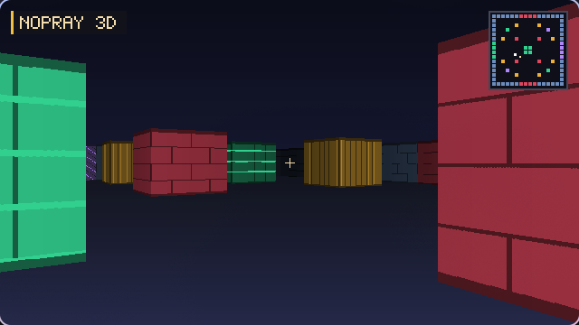
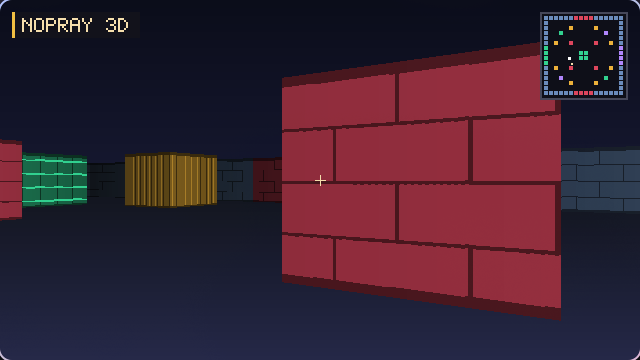
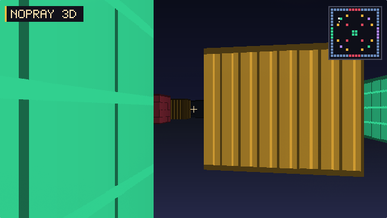
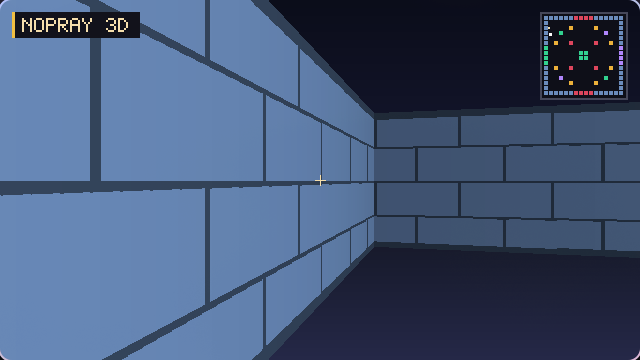

# Referencia #002 (`NOPRAY`) — `NOPRAY 3D`: Motor 3D Raycasting en Tiempo Real en 8,192 Bytes (`DMCS-L2` `W^X`)

Motor gráfico **3D en primera persona a 60 FPS** (`640×360` widescreen 16:9) sintetizado 100 % en código máquina `x86-64` crudo — con **5 materiales arquitectónicos procedurales**, conductos de energía animados en tiempo real, iluminación direccional, niebla atmosférica de profundidad, minimapa 2D en vivo con vector de dirección, modo tour autónomo, colisión deslizante y control FPS fluido `WASD` + flechas.

Construido bajo nivel **`DMCS-L2` (endurecido `W^X` con doble segmento `PT_LOAD` separado: `R-X` para código y `RW-` para datos/BSS)**.

---

## Certificado de Cumplimiento `NOPRAY-1.0 / DMCS-1.0`

```text
Standard:       NOPRAY-1.0 / DMCS-1.0 (Tier L2 — W^X Hardened Dual-Segment Raw Hex)
Target ISA/OS:  x86_64 / Linux (ELF64 static executable, SSE2 + x87 fsincos)
Binary Size:    8,192 bytes (0x2000 — 2 OS pages, exact match to PT_LOAD[0] p_filesz)
Memory RSS:     ~932 KB (includes 640x360x4 = 921,600 B software framebuffer in .bss)
W^X Segments:   PT_LOAD[0] 0x400000 (R E) | PT_LOAD[1] 0x404000 (RW , 1 MiB .bss)
SHA-256:        3a26bb5088b0de9b84d11012a4368b1937c0e72b37b8e1df284d3a2627cd8728
Dynamic Libs:   0 (ldd: "not a dynamic executable", no libc, no libX11, no OpenGL, no SDL)
Build Tool:     xxd -r -p nopray3d.hex nopray3d (zero compilers, zero assemblers, zero linkers)
Syscall Set:    read(0), write(1), poll(7), socket(41), connect(42), exit(60)
Verified On:    Cachyos-x8664 (Linux 7.3.5-2-cachyos, Hyprland + Xwayland :0), 2026-11-24
```

---

## Capturas Verificadas en Vivo (CachyOS + Hyprland `640×360`)

<p align="center">
  
  
</p>
<p align="center">
  
  
</p>

---

## Arquitectura Interna (`W^X` Dual-`PT_LOAD`, 785 Instrucciones Decodificadas)

### Segmento 0 — Solo Lectura + Ejecución (`PF_R | PF_X = 5`, `0x400000–0x401FFF`)

| Ranura Virtual | Tamaño Útil / Ranura | Subsistema |
| :--- | :--- | :--- |
| `0x400000–0x4000AF` | `176 B / 176 B` | Cabecera ELF64 + `PT_LOAD[0]` (`R E`, `0x400000`) + `PT_LOAD[1]` (`RW `, `0x404000`, `1 MiB`) |
| `0x4000B0–0x4000FF` | `66 B / 80 B` | Helpers de syscalls: `read_exact` (`0x0B0`), `write_all` (`0x0D0`), `exit_clean` (`0x0F0`) |
| `0x400100–0x40033F` | `530 B / 576 B` | **`_start`**: `r15 = 0x404000`, socket X11 `/tmp/.X11-unix/X0`, handshake, `CreateWindow 640×360` (`KeyPress\|KeyRelease\|Expose`), `WM_NAME("NOPRAY 3D")`, `WM_NORMAL_HINTS(640×360)`, `CreateGC`, `MapWindow`, posición inicial `(2.0, 6.5, 0.125)` |
| `0x400340–0x4004BF` | `235 B / 384 B` | **`main_loop`**: bucle no bloqueante a ~60 FPS con `poll(fd, 0)` para drenar eventos de teclado sostenido (`key_bits`) y `poll(fd, 16ms)` para ritmo de fotogramas sin quemar CPU |
| `0x4004C0–0x4006BF` | `416 B / 512 B` | **`update_player`**: trigonometría nativa en silicio (`x87 fsincos`), plano de cámara 16:9 (`FOV = 0.75`), tour autónomo con evasión anticipada de muros o control manual `WASD` + flechas + `Shift`, y colisión deslizante independiente en ejes X/Y |
| `0x4006C0–0x400AFF` | `919 B / 1,088 B` | **`render_3d`**: raycaster DDA en 640 columnas usando 16 registros `SSE2 double` sin *fisheye*, degradado de cielo/suelo, 5 materiales procedurales (`1` ladrillo azul catedral, `2` columna dorada acanalada con brillo especular, `3` santuario carmesí, `4` núcleo de silicio esmeralda con líneas animadas por `frame_tick`, `5` obelisco amatista con entramado cristalino XOR), sombra direccional `N/S vs E/O` y niebla atmosférica por distancia |
| `0x400B00–0x400BFF` | `137 B / 256 B` | Primitivas de dibujo (`fill_rect` con `rep stosd` + `draw_glyph` bitmap `5×7` sobre stride `640×4 = 0xA00`) |
| `0x400C00–0x400E7F` | `464 B / 640 B` | **`draw_hud`**: mira central dorada, insignia superior izquierda `NOPRAY 3D` y minimapa 2D en color `80×80` con jugador y vector de vista en tiempo real |
| `0x400E80–0x400FFF` | `128 B / 384 B` | **`blit_x11`**: blitteo sin parpadeo en 4 franjas X11 `PutImage` (`640×90`, `230,400 B` c/u) |
| `0x401000–0x401FFF` | `832 B / 4,096 B` | **`.rodata`**: `sockaddr_un`, `WM_SIZE_HINTS`, 24 constantes `IEEE-754 double` exactas (incluyendo `ABS_MASK` alineada a 16B en `0x401100`), paleta RGB de materiales, tabla de teclas, mapa arquitectónico `16×16` (256 B) y fuente `5×7` de HUD |

### Segmento 1 — Solo Lectura + Escritura (`PF_R | PF_W = 6`, `0x404000–0x503FFF`)
- `0x404000–0x40407F`: Estado en tiempo real (posición, ángulo, vector dirección, plano cámara, `key_bits`, `auto_tour`, `show_map`, `frame_tick`, `pollfd`).
- `0x404080–0x407FFF`: Búferes de eventos, peticiones y handshake X11.
- `0x408000–0x4E8FFF`: Framebuffer BGRA `640×360×4` (`921,600` bytes).

---

## Controles en Vivo

| Tecla | Acción |
| :--- | :--- |
| **`W` / `S`** o **`↑` / `↓`** | Avanzar / retroceder (desactiva automáticamente el tour y entrega control manual inmediato) |
| **`A` / `D`** o **`←` / `→`** | Girar izquierda / derecha suavemente |
| **`Shift`** | Sprint (`2×` velocidad) |
| **`Espacio`** | Activar / pausar el modo **tour 3D autónomo** |
| **`M`** | Mostrar / ocultar el **minimapa 2D** |
| **`Q`** o **`Esc`** | Cerrar limpio (`exit(0)`) |

---

## Replicación y Auditoría Forense (En Cualquier Linux `x86_64` con X11/Xwayland)

```bash
# 1. Materializar directamente desde el hexadecimal crudo
xxd -r -p nopray3d.hex nopray3d
chmod +x nopray3d

# 2. Verificar pureza, W^X y hash bit a bit
wc -c nopray3d        # 8192
sha256sum nopray3d    # 3a26bb5088b0de9b84d11012a4368b1937c0e72b37b8e1df284d3a2627cd8728
ldd nopray3d          # not a dynamic executable
readelf -h -l nopray3d  # Verifica 2 PT_LOAD: R E (0x400000) y RW (0x404000)

# 3. Auditar las 6 únicas syscalls en todo el ejecutable
objdump -D -b binary -m i386:x86-64 -M intel --adjust-vma=0x400000 \
  --start-address=0x4000b0 --stop-address=0x401000 nopray3d | grep -B 3 'syscall'

# 4. Ejecutar
DISPLAY=:0 ./nopray3d
```

---

## Mapa NOPRAY (`DMCS-1.1`)

Este directorio es ahora una app mapeada: `nopray.toml` declara segmentos, ranuras, contratos y
syscalls; `slots/` contiene los bytes anotados; `build/MAP.md` es el mapa navegable.
`nopray3d.hex` se conserva como referencia histórica y es idéntico byte a byte a la versión mapeada.

- Nivel: L2 (W^X).
- Auditoría: 0 errores; avisos: sin PT_GNU_STACK (S003) y caída de `_start` en `main_loop` (C015).
- Reproducir: `../../tools/nopray.sh audit .` (escribe `build/audit.json` y `build/MAP.md`).
